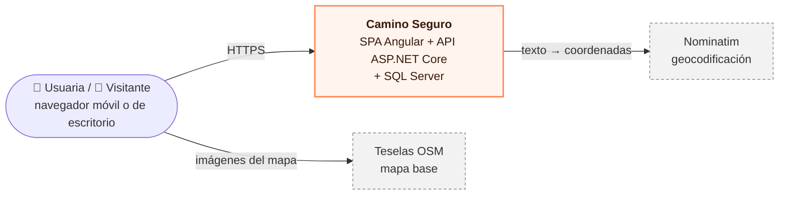
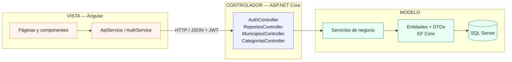

# Camino Seguro — Documento de arquitectura y decisiones técnicas

**Estándar de referencia:** ISO/IEC/IEEE 42010:2022 (descripción de arquitectura) · **Versión:** 1.0 · **Fecha:** 4 de noviembre de 2026
**Equipo:** Yeison Hernández (frontend) · Alejandro Martínez (backend) · Alejandro Nieto (repositorios, despliegue y documentación)
**Contexto:** Hackatón, ciclo de Profundización. Problema 6: *Ruta segura para mujeres en el espacio público nocturno*.

---

## 1. Introducción

### 1.1 Propósito
Este documento describe la arquitectura de **Camino Seguro** y justifica las decisiones técnicas tomadas. Está dirigido al jurado y a quien tenga que mantener o ampliar el sistema.

### 1.2 Alcance del sistema
Aplicación web colaborativa en la que usuarias autenticadas con **JWT** reportan puntos de riesgo en el espacio público de Cundinamarca: acoso, iluminación deficiente, zonas desoladas y otros. Cada reporte tiene una ubicación textual (municipio y punto de referencia) y una categoría. Los reportes se consultan en una **lista ordenada por cercanía**, se pueden **filtrar por tipo de riesgo** y se ven en un **mapa** construido con una API externa (OpenStreetMap).

**Fuera de alcance**, por decisión del enunciado: seguimiento en tiempo real y botón de pánico conectado a las autoridades.

### 1.3 Requisitos y cómo se cumplen

| Requisito | Cómo se cumple | Dónde |
|---|---|---|
| R1. Reporte con usuaria autenticada (JWT), municipio, punto de referencia y categoría | `POST /api/reportes` con `[Authorize]` y formulario validado | `ReportesController`, `pages/reportar` |
| R2. Lista ordenada por cercanía | Tabla precargada de municipios y geocodificación con Nominatim; distancia calculada con **Haversine** | `ReporteService`, `GET /api/reportes` |
| R2b. Filtro por tipo de riesgo | Parámetro `categoriaId` y chips de filtro en la interfaz | `pages/inicio` |
| R3. API externa con mapa | Teselas de **OpenStreetMap** dibujadas con **Leaflet**, más **Nominatim** para geocodificar | `shared/mapa.ts`, `NominatimGeocodingService` |
| Profundización: MVC | Modelo y controladores en ASP.NET Core; la vista es una SPA en Angular | §3.2 |
| Profundización: despliegue en la nube | Docker Compose en una instancia en la nube | §3.4 y manual técnico |

### 1.4 Referencias
- ISO/IEC/IEEE 42010:2022, *Systems and software engineering — Architecture description*.
- OWASP Top 10 (2021) y la OWASP ASVS como guía de controles de seguridad.
- Ley 1581 de 2012 de Colombia (protección de datos personales).
- Políticas de uso de Nominatim y de las teselas de OpenStreetMap.
- Anexo A: `02-diagramas-uml.md`, con los 12 diagramas UML en Mermaid.

---

## 2. Partes interesadas y preocupaciones

| Parte interesada | Preocupación principal | Vista que la responde |
|---|---|---|
| Usuarias (mujeres de Cundinamarca) | Reportar rápido desde el celular, sin exponer su identidad | Funcional, seguridad |
| Visitantes | Saber qué zonas evitar cerca de donde están | Funcional, procesos |
| Jurado | Cumplimiento de requisitos, MVC, JWT, API externa, nube, UX y seguridad | Todas |
| Equipo de desarrollo | Trabajar en paralelo sin bloquearse y desplegar en poco tiempo | Desarrollo, física |
| OpenStreetMap | Que se respeten sus políticas de uso | Procesos (ADR-05) |

---

## 3. Vistas de arquitectura

### 3.1 Vista de contexto

### 3.2 Vista lógica: MVC con la vista desacoplada

Aplicamos **MVC distribuido**. El **Modelo** (entidades de EF Core y DTOs) y los **Controladores** (`ApiController`) viven en la API de .NET. La **Vista** es la SPA de Angular, que se comunica con los controladores mediante JSON sobre HTTP. Entre el controlador y los datos agregamos una **capa de servicios** para que los controladores no contengan reglas de negocio.

**Por qué así:** la misma API podría servir mañana a una app móvil sin cambiarla, y frontend y backend se desarrollaron en paralelo gracias a un contrato JSON acordado desde el principio (ADR-02). Los diagramas de clases detallados son los diagramas 2, 3 y 4 del Anexo A.

### 3.3 Vista de procesos
Hay tres flujos críticos, con su diagrama de secuencia en el Anexo A:
- **Iniciar sesión (diagrama 5):** BCrypt verifica la contraseña, se emite un JWT HS256 que expira en 2 h, y el login tiene *rate limiting*.
- **Crear reporte (diagrama 6):** Nominatim geocodifica el punto de referencia con un timeout de 5 s. Si no lo encuentra, se usa el **centro del municipio** y se guarda de dónde salieron las coordenadas.
- **Listar por cercanía (diagrama 7):** se filtra en SQL y se ordena en memoria con Haversine. El volumen de reportes por municipio es bajo, así que esto es más simple que usar tipos `geography`.

### 3.4 Vista física (despliegue)
Se despliega con **Docker Compose en una instancia en la nube** (diagrama 11). Hay tres contenedores: `web` (nginx sin privilegios con Angular compilado), `api` (ASP.NET Core 10 con el usuario `app`) y `db` (SQL Server 2022 Express con un volumen persistente). **Solo `web` publica un puerto.** nginx reenvía `/api/*` a la API, así que el navegador ve un único origen y no hace falta abrir CORS. La API y la base de datos no son accesibles desde internet.

### 3.5 Vista de información
Hay cinco tablas: `Usuarios`, `Municipios`, `Categorias`, `Reportes` y `Confirmaciones` (diagrama 12).
- `Reportes` guarda las coordenadas ya calculadas, para no geocodificar dos veces.
- `Confirmaciones` tiene una restricción única `(ReporteId, UsuarioId)`.
- El reporte guarda internamente el `UsuarioId`, para saber quién puede editarlo, pero la API **nunca lo expone**: solo muestra el alias o «Anónima».

---

## 4. Decisiones de arquitectura (ADR)

| ID | Decisión | Alternativas consideradas | Justificación |
|---|---|---|---|
| ADR-01 | SPA en Angular 22 y API REST en ASP.NET Core 10 (MVC distribuido) | MVC con vistas Razor | Separa responsabilidades, permite trabajo en paralelo y deja la API lista para otros clientes |
| ADR-02 | **Contrato primero** y un **backend simulado** en Angular (`mockBackendInterceptor`) | Esperar a que la API estuviera lista | El frontend se desarrolló y probó desde la primera hora; para pasar a la API real solo se cambia un parámetro |
| ADR-03 | JWT HS256 de 2 h, firmado con una clave de ≥ 32 bytes leída de variables de entorno | Cookies de sesión | Lo exige el enunciado; no requiere guardar estado en el servidor. La clave nunca está en el repositorio |
| ADR-04 | BCrypt (`BCrypt.Net-Next`) con *work factor* 11–12 | SHA-256 con sal | Es lento a propósito y resistente a fuerza bruta |
| ADR-05 | **Nominatim** llamado solo desde el backend, con *User-Agent* propio, timeout de 5 s y respaldo con el centro del municipio | Llamarlo desde el navegador; API de Google | Es gratuito, respeta la política de 1 petición/s y la app no se cae si el servicio falla |
| ADR-06 | **Haversine** en memoria después de filtrar en SQL | Tipo `geography` de SQL Server | Es suficientemente preciso a escala municipal y mucho más simple |
| ADR-07 | **Leaflet** con marcadores circulares coloreados por categoría | Google Maps; marcadores con imágenes | Gratuito, liviano y sin imágenes que se pierdan al desplegar |
| ADR-08 | Reporte **anónimo hacia las demás**, pero con autora registrada internamente | Reportes totalmente anónimos sin cuenta | Cumple R1 y permite que solo la autora edite o borre; protege la identidad (Ley 1581) |
| ADR-09 | Docker Compose en una instancia, con nginx como proxy inverso | PaaS separados (App Service + Netlify) | Un solo comando despliega todo y hay un solo origen, sin CORS. El PaaS queda como alternativa en el manual técnico |
| ADR-10 | Interfaz con **tema nocturno**, tipografía *Atkinson Hyperlegible* y diseño pensado primero para celular | Tema claro genérico | La app se usa de noche y en la calle: da menos brillo, se lee mejor y tiene botones fáciles de tocar |

---

## 5. Seguridad (20 % de la calificación)

| Riesgo (OWASP) | Control aplicado |
|---|---|
| A01 Control de acceso roto | `[Authorize]` en las escrituras. El servidor compara el `sub` del token con el `UsuarioId` del reporte y responde 403 si no coinciden. Los *guards* de Angular son solo una ayuda de UX |
| A02 Fallas criptográficas | Contraseñas con BCrypt. Clave JWT de ≥ 32 bytes en variables de entorno (`.env` fuera de git). HTTPS en la nube |
| A03 Inyección (SQL) | EF Core genera consultas parametrizadas; no se usa `FromSqlRaw` con texto concatenado. Los DTOs se validan con longitudes, rangos e ids existentes |
| A03 Inyección (XSS) | Angular escapa todas las interpolaciones; no se usa `innerHTML`. Los popups de Leaflet se arman con `textContent`. La CSP de nginx tiene `script-src 'self'` |
| A04 Diseño inseguro | El formulario advierte que no se escriban nombres ni datos de personas: se reportan **lugares**. El correo nunca se expone. El GPS se redondea a unos 100 m y no se guarda |
| A05 Configuración insegura | CORS restringido al origen propio. nginx con `server_tokens off` y cabeceras `X-Frame-Options`, `nosniff`, `Referrer-Policy` y `Permissions-Policy`. Contenedores sin root. La base de datos no se expone |
| A07 Fallas de autenticación | *Rate limiting* en el login y en la creación de reportes. Mensaje genérico «Credenciales inválidas». Expiración de 2 h y cierre de sesión automático al recibir un 401 |
| A10 SSRF y redirecciones | El parámetro `?volver=` solo acepta rutas internas. El backend solo consulta un host fijo (Nominatim) |

---

## 6. Atributos de calidad: UX y usabilidad (35 % de la calificación)
- **Diseño para celular:** lista y mapa en pestañas en el celular y lado a lado en pantallas grandes. Botón flotante «Reportar» y botón de enviar siempre visibles abajo, al alcance del pulgar.
- **Retroalimentación inmediata:** esqueletos de carga, mensajes cortos de confirmación o error, la confirmación «A mí también» se ve al instante (y se revierte si falla), y estados vacíos que invitan a reportar.
- **Accesibilidad:** contraste alto, objetivos táctiles de al menos 40 px, `aria-*` en los controles, enlace para saltar al contenido, foco en el primer error del formulario y respeto por `prefers-reduced-motion`.
- **Prevención de errores:** validación en el cliente y en el servidor, contador de caracteres, confirmación antes de borrar y aviso cuando la ubicación es aproximada.

---

## 7. Riesgos, limitaciones y trabajo futuro

| Riesgo o limitación | Mitigación actual | Trabajo futuro |
|---|---|---|
| No se puede verificar que quien se registra sea mujer | Términos de uso y reportes centrados en lugares | Verificación con aliadas (universidades, alcaldías) |
| Reportes falsos o abusivos | Las confirmaciones sirven como señal de confianza | Moderación, botón «reportar abuso», reputación |
| Nominatim no encuentra referencias locales | Respaldo con el centro del municipio, avisado en la interfaz | Selector de punto sobre el mapa y geocodificación inversa |
| Token en `localStorage` | Escapado de Angular, CSP y expiración corta | Cookie `HttpOnly` + `SameSite` con *refresh tokens* |
| Una sola instancia | Reinicio automático de los contenedores y volumen persistente | Base de datos gestionada, réplicas y respaldos automáticos |
| Sin análisis por horario | Se guarda la franja horaria | Mapa de calor por franja y alertas por zona |
