# Camino Seguro — Diagramas UML

**Anexo A del documento de arquitectura (v1.1)** · Hackatón, ciclo de Profundización · 4 de noviembre de 2026
Equipo: Yeison Hernández · Alejandro Martínez · Alejandro Nieto

Todos los diagramas están escritos como código Mermaid. GitHub los muestra dibujados al abrir este archivo. Para exportarlos como imagen se puede usar https://mermaid.live.

| # | Diagrama | Tipo UML | Vista (IEEE 42010) |
|---|---|---|---|
| 1 | Casos de uso | Comportamiento | Funcional |
| 2 | Modelo de dominio | Estructura (clases) | Lógica |
| 3 | Clases del backend por capas (MVC) | Estructura (clases) | Lógica |
| 4 | Clases del frontend | Estructura (clases) | Lógica |
| 5 | Secuencia: iniciar sesión | Interacción | Procesos |
| 6 | Secuencia: crear reporte con geocodificación | Interacción | Procesos |
| 7 | Secuencia: listar reportes por cercanía | Interacción | Procesos |
| 8 | Actividad: reportar un punto de riesgo | Comportamiento | Procesos |
| 9 | Estados: sesión de la usuaria | Comportamiento | Procesos |
| 10 | Componentes | Estructura | Desarrollo |
| 11 | Despliegue | Estructura | Física |
| 12 | Entidad-relación | Datos | Información |

---

## 1. Casos de uso

Mermaid no tiene un tipo propio para casos de uso. Se representan con un diagrama de flujo: los actores van a los lados y los casos de uso, con forma de óvalo, dentro del límite del sistema. Las flechas punteadas indican relaciones `«include»` y `«extend»`.

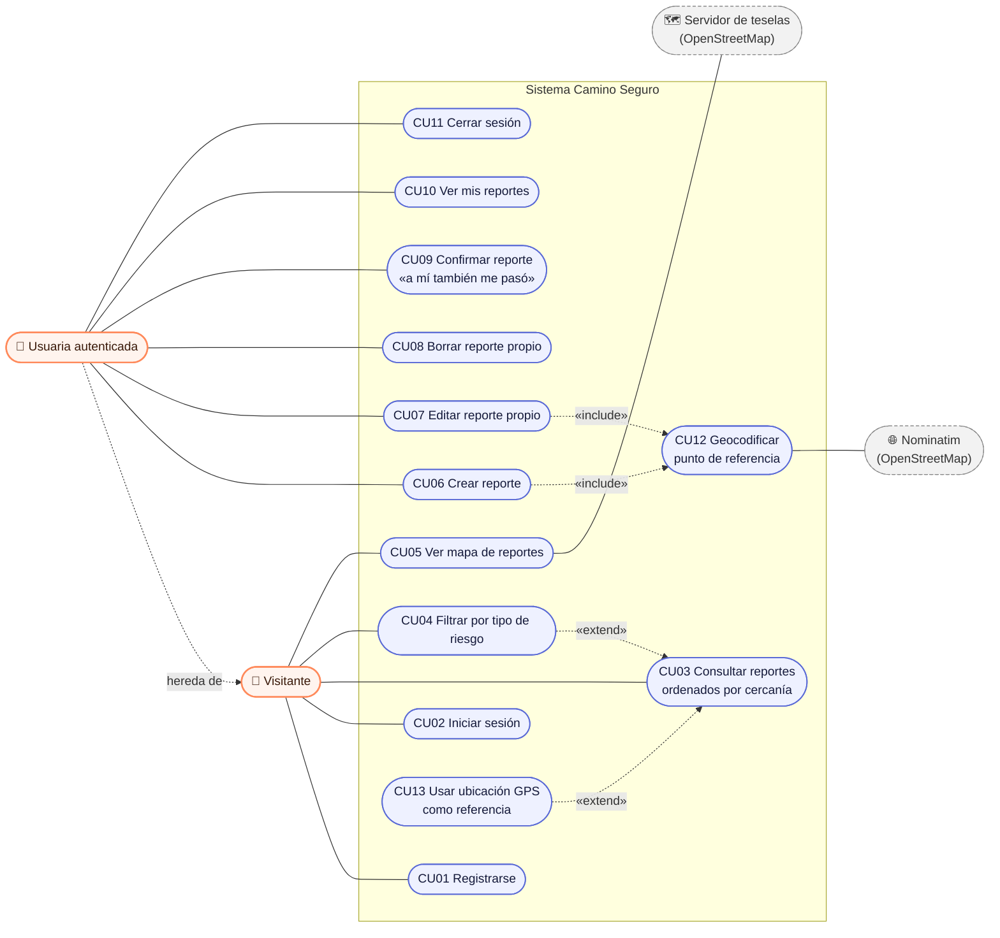

### Especificación resumida de los casos de uso

| ID | Nombre | Actor | Precondición | Flujo principal | Postcondición |
|---|---|---|---|---|---|
| CU01 | Registrarse | Visitante | No tiene cuenta | Ingresa alias (3 a 30 caracteres), correo y contraseña (mínimo 8 caracteres, con letras y números) y acepta la Ley 1581 | Cuenta creada y sesión iniciada con JWT |
| CU02 | Iniciar sesión | Visitante | Tiene cuenta | Ingresa correo y contraseña; el sistema la verifica con PBKDF2 (`PasswordHasher`) | Recibe un JWT válido por 2 h |
| CU03 | Consultar reportes | Visitante | — | Elige un municipio o su GPS; el sistema calcula la distancia con Haversine | Lista ordenada de menor a mayor distancia |
| CU04 | Filtrar por tipo | Visitante | Lista cargada | Toca una categoría | Solo se ven los reportes de esa categoría |
| CU05 | Ver mapa | Visitante | Lista cargada | Cambia a la pestaña Mapa | Puntos de colores por categoría |
| CU06 | Crear reporte | Usuaria | Sesión activa | Elige categoría, municipio y punto de referencia; detalles opcionales | Reporte guardado con coordenadas |
| CU07 | Editar reporte | Usuaria | Ser la autora | Modifica los campos | Reporte actualizado (403 si no es la autora) |
| CU08 | Borrar reporte | Usuaria | Ser la autora | Confirma el borrado | Reporte y sus confirmaciones eliminados |
| CU09 | Confirmar reporte | Usuaria | Sesión activa y no ser la autora | Toca «A mí también» | Contador +1; una sola vez por usuaria |
| CU10 | Mis reportes | Usuaria | Sesión activa | Abre «Mis reportes» | Lista de sus reportes |
| CU11 | Cerrar sesión | Usuaria | Sesión activa | Toca «Salir» | Token eliminado del navegador |
| CU12 | Geocodificar | Sistema | CU06 o CU07 | Consulta Nominatim; si no hay resultado o queda a más de 25 km del municipio, usa el centro del municipio | Coordenadas y fuente guardadas |
| CU13 | Usar GPS | Visitante | Navegador con permiso de ubicación | Acepta el permiso | Referencia redondeada a unos 100 m, sin guardarse |

---

## 2. Modelo de dominio

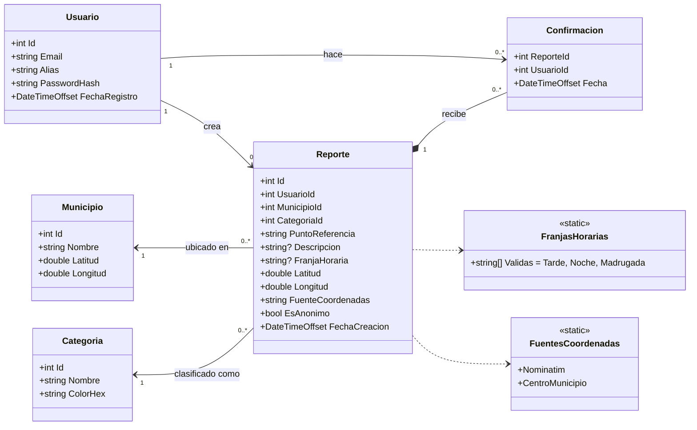

---

## 3. Clases del backend por capas (MVC + servicios), ASP.NET Core 8

**Model** = entidades, DTOs y `AppDbContext` · **Controller** = `AuthController`, `CatalogosController` y `ReportesController` · **View** = la SPA de Angular, que consume JSON (diagrama 4). Los servicios agrupan lo reutilizable: emitir el JWT, geocodificar, calcular distancias y armar el JSON.

```mermaid
classDiagram
    direction TB

    namespace Controllers {
        class AuthController {
            +Registro(RegistroRequest) Task~ActionResult~AuthResponse~~
            +Login(LoginRequest) Task~ActionResult~AuthResponse~~
        }
        class ReportesController {
            +Listar(lat, lng, municipioRefId, categoriaId) Task~ActionResult~List~ReporteDto~~~
            +Obtener(int id) Task~ActionResult~ReporteDto~~
            +Mios() Task~ActionResult~List~ReporteDto~~~
            +Crear(ReporteRequest) Task~ActionResult~ReporteDto~~
            +Editar(int id, ReporteRequest) Task~ActionResult~ReporteDto~~
            +Borrar(int id) Task~IActionResult~
            +Confirmar(int id) Task~IActionResult~
            +QuitarConfirmacion(int id) Task~IActionResult~
        }
        class CatalogosController {
            +Listar() Task~List~MunicipioDto~~
            +Listar() Task~List~CategoriaDto~~
        }
    }

    namespace Services {
        class TokenService {
            -JwtOptions opciones
            +Crear(Usuario u) (Token, ExpiraEn)
        }
        class JwtOptions {
            +string Key
            +string Issuer
            +string Audience
            +int HorasExpiracion
        }
        class IGeocodingService {
            <<interface>>
            +BuscarAsync(referencia, Municipio m) Task~(Lat, Lng)?~
        }
        class NominatimGeocodingService {
            -HttpClient http
            -double DistanciaMaximaKm = 25
        }
        class Geo {
            <<static>>
            +DistanciaKm(lat1, lng1, lat2, lng2) double
        }
        class ReporteMapper {
            <<static>>
            +ADto(Reporte r, int? usuarioActual, referencia) ReporteDto
        }
    }

    namespace Data {
        class AppDbContext {
            +DbSet~Usuario~ Usuarios
            +DbSet~Reporte~ Reportes
            +DbSet~Municipio~ Municipios
            +DbSet~Categoria~ Categorias
            +DbSet~Confirmacion~ Confirmaciones
            #OnModelCreating(ModelBuilder)
        }
        class Semilla {
            <<static>>
            +18 municipios
            +6 categorías
        }
    }

    namespace Dtos {
        class ReporteRequest {
            +int MunicipioId
            +int CategoriaId
            +string PuntoReferencia
            +string? Descripcion
            +string? FranjaHoraria
            +bool EsAnonimo
            +Validate() IEnumerable~ValidationResult~
        }
        class ReporteDto {
            +int Id
            +string Categoria
            +string ColorHex
            +string Municipio
            +string PuntoReferencia
            +double Latitud
            +double Longitud
            +string Autor
            +int Confirmaciones
            +bool YaConfirme
            +bool EsMio
            +double? DistanciaKm
        }
        class AuthResponse {
            +string Token
            +DateTime ExpiraEn
            +string Alias
            +string Email
        }
    }

    class PasswordHasher~Usuario~ {
        <<ASP.NET Core Identity>>
        +HashPassword()
        +VerifyHashedPassword()
    }

    NominatimGeocodingService ..|> IGeocodingService
    TokenService --> JwtOptions
    AuthController --> AppDbContext
    AuthController --> TokenService
    AuthController --> PasswordHasher~Usuario~
    CatalogosController --> AppDbContext
    ReportesController --> AppDbContext
    ReportesController --> IGeocodingService
    ReportesController ..> ReporteMapper
    ReporteMapper ..> Geo
    NominatimGeocodingService ..> Geo : valida 25 km
    AppDbContext ..> Semilla : HasData
    ReporteMapper ..> ReporteDto : produce
    ReportesController ..> ReporteRequest : recibe
```

---

## 4. Clases del frontend (Angular)

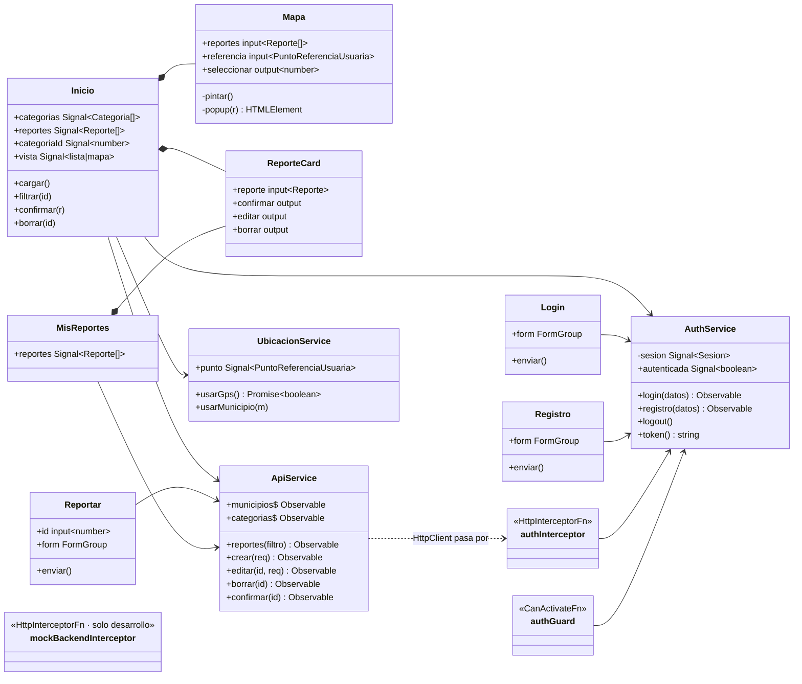

---

## 5. Secuencia: iniciar sesión (JWT)

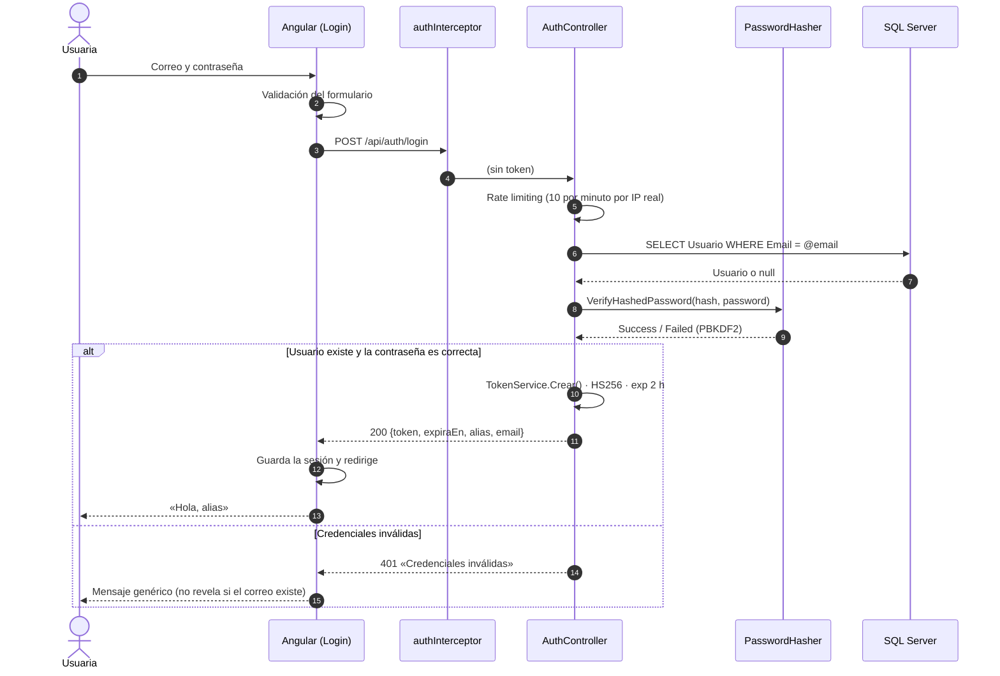

---

## 6. Secuencia: crear reporte con geocodificación y respaldo

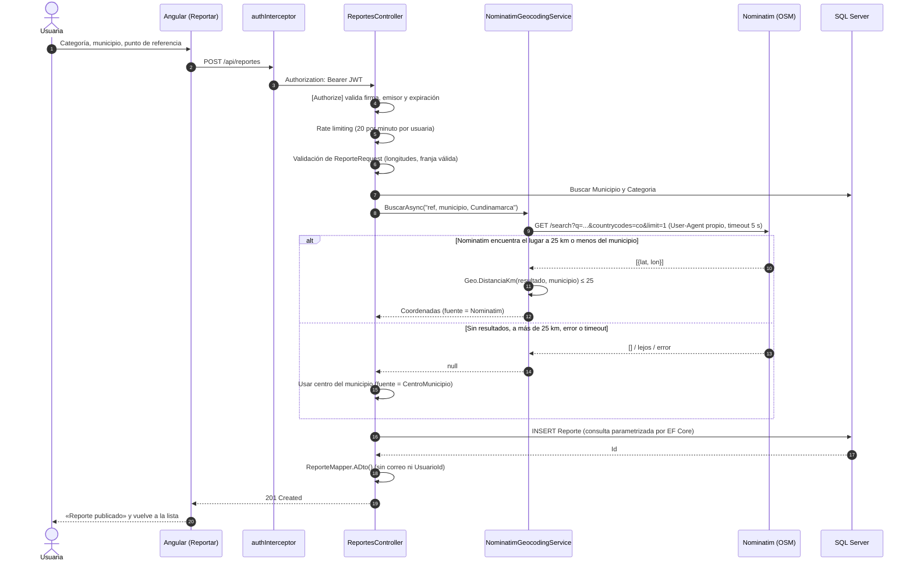

---

## 7. Secuencia: listar reportes por cercanía (Haversine)

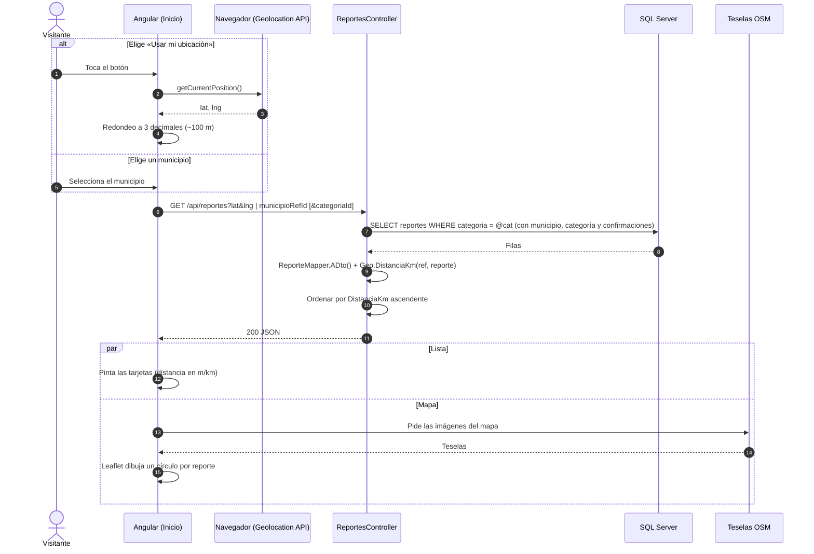

---

## 8. Actividad: reportar un punto de riesgo

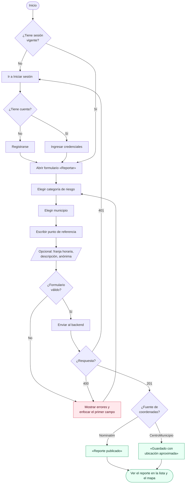

---

## 9. Estados: sesión de la usuaria

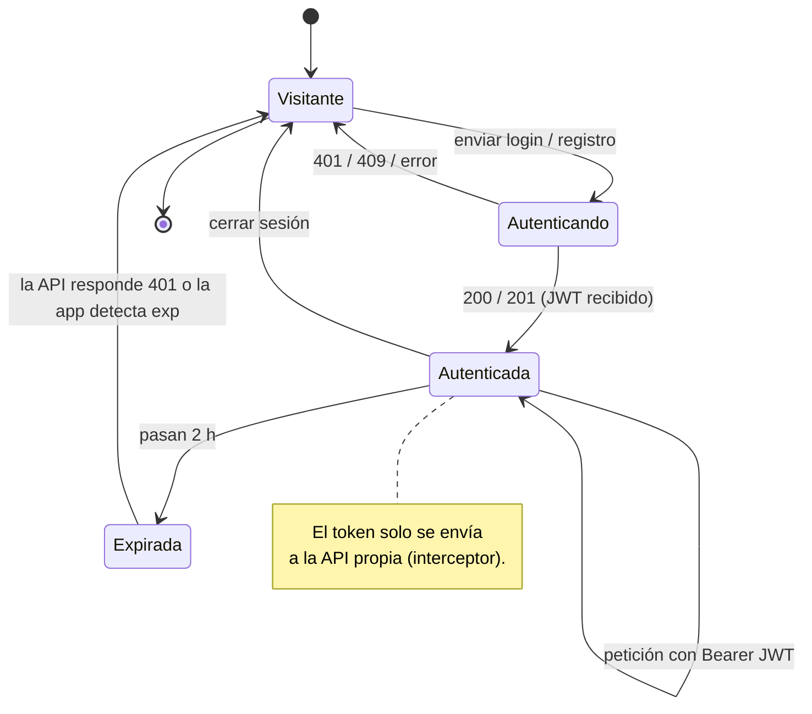

---

## 10. Componentes

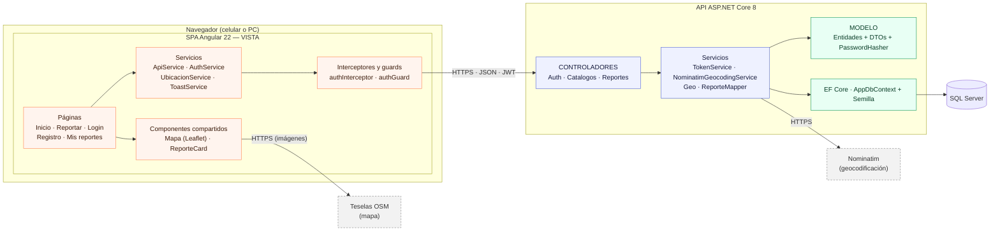

---

## 11. Despliegue (Docker en una instancia)

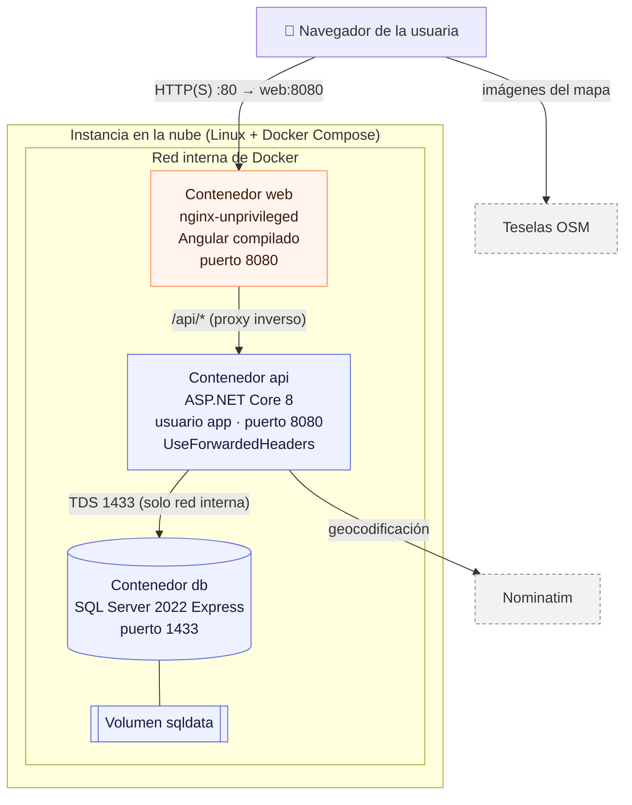

Solo el contenedor `web` publica un puerto hacia internet. La API y la base de datos solo son accesibles dentro de la red interna de Docker.

---

## 12. Entidad-relación (SQL Server)

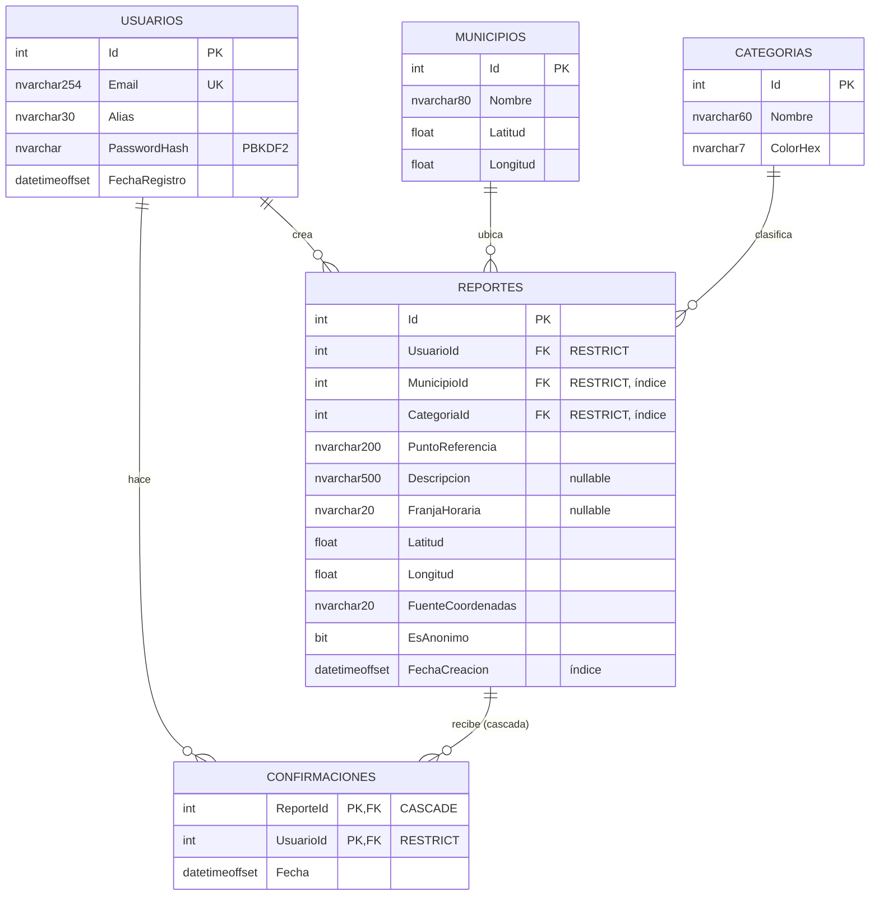

**Llave primaria compuesta:** `CONFIRMACIONES (ReporteId, UsuarioId)`, así que nadie puede confirmar dos veces el mismo reporte.
**Nota técnica:** las llaves hacia `USUARIOS` usan `RESTRICT` y solo `ReporteId` usa cascada. Si hubiera dos caminos de cascada hacia `CONFIRMACIONES`, SQL Server rechazaría el esquema por *multiple cascade paths*.
**Datos iniciales (`Semilla`):** 18 municipios de Cundinamarca y la zona metropolitana, y 6 categorías: Poca iluminación, Zona solitaria, Acoso callejero, Robo o atraco, Transporte inseguro y Otro.
