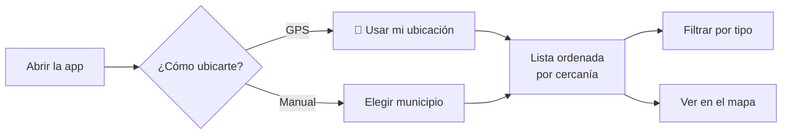

# Camino Seguro — Manual de usuario

**Versión 1.1 · 4 de noviembre de 2026**

Camino Seguro es un mapa colaborativo donde las mujeres de Cundinamarca señalan los **lugares** que sienten inseguros de noche, para que otras puedan planear rutas más seguras.

> **Importante:** Camino Seguro no reemplaza a las autoridades. En una emergencia, llama a la **Línea 123** o a la **Línea 155** (orientación a mujeres víctimas de violencia).

---

## 1. Qué puedes hacer

| Sin cuenta | Con cuenta |
|---|---|
| Ver los reportes cercanos | Todo lo anterior, y además: |
| Filtrar por tipo de riesgo | Reportar un punto de riesgo |
| Ver el mapa | Confirmar reportes de otras («A mí también») |
| | Editar o borrar tus propios reportes |

---

## 2. Ver las zonas de riesgo cerca de ti

1. Abre la aplicación. Verás **«Zonas de riesgo reportadas»**.
2. Elige desde dónde medir la cercanía:
   - Toca **📍 Usar mi ubicación** y acepta el permiso del navegador. Tu ubicación **no se guarda** y se redondea a unos 100 metros.
   - O elige tu **municipio** en la lista (hay 18 de Cundinamarca y la zona metropolitana). La app lo recuerda para la próxima vez.
3. Los reportes aparecen **del más cercano al más lejano**, con la distancia en metros o kilómetros.

### Filtrar por tipo de riesgo
Debajo de la ubicación hay botones con colores. Toca uno para ver solo esa categoría. Toca **Todos**, o la misma categoría otra vez, para quitar el filtro.

| Color | Categoría |
|---|---|
| 🟠 Ámbar | Poca iluminación |
| ⚪ Gris | Zona solitaria |
| 🔴 Rojo | Acoso callejero |
| 🟣 Morado | Robo o atraco |
| 🔵 Azul claro | Transporte inseguro |
| 🟢 Verde azulado | Otro |

### Ver el mapa
- **En el celular:** toca la pestaña **Mapa**.
- **En el computador:** el mapa aparece al lado de la lista.
- Cada círculo es un reporte, con el color de su categoría. Tócalo para ver los detalles.
- El **punto azul** es tu ubicación o tu municipio de referencia.
- En una tarjeta de la lista, **📍 Mapa** lleva al reporte en el mapa.

---

## 3. Crear tu cuenta

1. Toca **Crear cuenta** (en el celular, abre el menú ☰).
2. Escribe un **alias** de 3 a 30 caracteres. Es como te verán si no reportas como anónima; no uses tu nombre completo.
3. Escribe tu **correo** y una **contraseña** de mínimo 8 caracteres con letras y números. Repítela.
4. Acepta el tratamiento de datos. Solo se guardan tu correo, tu alias y tus reportes.
5. Toca **Crear cuenta**. Quedas con la sesión iniciada.

**Iniciar sesión después:** toca **Ingresar** y escribe tu correo y contraseña. Por seguridad, la sesión dura **2 horas**. Cuando expira, la app te pide ingresar de nuevo.

---

## 4. Reportar un punto de riesgo

1. Toca el botón naranja **＋ Reportar**.
2. **¿Qué tipo de riesgo es?** Toca una de las seis categorías.
3. **¿Dónde queda?**
   - Elige el **municipio**.
   - Escribe un **punto de referencia** que todas reconozcan, por ejemplo *«Parque principal, esquina de la iglesia»* o *«Paradero frente a la universidad»*.
4. **Detalles (opcional):**
   - La franja horaria en que es más riesgoso: Tarde, Noche o Madrugada.
   - Una descripción de hasta 500 caracteres. ⚠️ **No escribas nombres, teléfonos ni datos de personas.** Se reportan lugares, no personas.
5. **Publicar como anónima** viene activado. Si lo desactivas, se mostrará tu alias. **Tu correo nunca se muestra.**
6. Toca **Publicar reporte**.

Si la app no encuentra el lugar exacto, o lo encuentra lejos del municipio elegido, ubica el reporte en el **centro del municipio** y te lo avisa. En la tarjeta aparece como «ubicación aprox.».

---

## 5. Confirmar el reporte de otra persona
Si a ti también te pasó algo en ese lugar, toca **A mí también** en la tarjeta. El contador sube y el botón cambia a **✓ Me pasó**. Tócalo otra vez para quitar tu confirmación. No puedes confirmar tus propios reportes, y solo cuenta una vez por persona.

---

## 6. Editar o borrar tus reportes
- En la lista, tus reportes dicen **«Tu reporte»** y tienen los botones **Editar** y **Borrar**.
- También los encuentras todos en **Mis reportes** (en el menú).
- El borrado pide confirmación y **no se puede deshacer**.

---

## 7. Preguntas frecuentes

| Pregunta | Respuesta |
|---|---|
| ¿Alguien puede ver mi correo? | No. Nunca se muestra a otras usuarias. |
| ¿La app guarda dónde estoy? | No. El GPS solo se usa para ordenar la lista, redondeado, y no se guarda. |
| ¿Puedo usarla sin cuenta? | Sí, para ver reportes y el mapa. Para reportar o confirmar necesitas cuenta. |
| ¿Por qué me pide ingresar otra vez? | La sesión dura 2 horas por seguridad. |
| Dice «Demasiados intentos» | Por seguridad hay un máximo de intentos por minuto. Espera un minuto y vuelve a intentar. |
| No aparecen reportes | Prueba con **Todos** en el filtro o con otro municipio. Si no hay, ¡haz el primero! |
| El mapa se ve gris | Revisa tu conexión a internet: el mapa se carga desde OpenStreetMap. |
