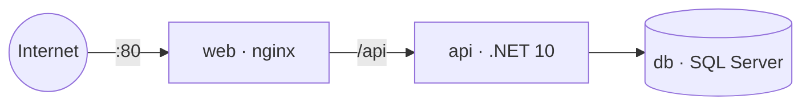

# Camino Seguro — Manual técnico (instalación, ejecución y despliegue)

**Versión 1.0 · 4 de noviembre de 2026**

## 1. Repositorios y estructura

| Repositorio | Carpeta local | Contenido |
|---|---|---|
| https://github.com/sergionieto1604/caminoSeguro | `camino_segurofront/` | SPA Angular, Dockerfile del frontend, `nginx.conf`, `deploy/` (docker-compose) y `docs/` |
| https://github.com/sergionieto1604/caminoSeguroBack | `camino_seguroback/` | API ASP.NET Core 10, EF Core y `Dockerfile` |

```
hackaton/
├── camino_segurofront/
│   ├── src/app/{core,shared,pages}
│   ├── Dockerfile · nginx.conf · .dockerignore
│   ├── deploy/{docker-compose.yml, .env.example, Dockerfile.backend}
│   └── docs/
└── camino_seguroback/
    ├── CaminoSeguro.Api/   (Controllers, Services, Models, Dtos, Data, Migrations)
    └── Dockerfile          (copiado desde deploy/Dockerfile.backend)
```

## 2. Requisitos

| Herramienta | Versión | Comprobar |
|---|---|---|
| Node.js | **≥ 24.15.0** o **≥ 26.0.0** (Angular 22.2 rechaza la 24.14) | `node -v` |
| Angular CLI | 22.2.5 (viene incluido en el proyecto) | `npx ng version` |
| .NET SDK | 10.0 | `dotnet --version` |
| SQL Server | 2022 Express/Developer, o el contenedor de Docker | SSMS |
| Docker + Compose | Docker 24 o superior | `docker compose version` |
| Git | 2.40 o superior | `git --version` |

---

## 3. Ejecución local

### 3.1 Frontend en modo demo (sin backend)
```bash
cd camino_segurofront
npm install
npm start                 # http://localhost:4200
```
Usuaria demo: `demo@demo.com` / `Demo1234`. Los datos viven en memoria (`core/mock-backend.interceptor.ts`) y se pierden al recargar.

### 3.2 Frontend conectado a la API real
En `src/environments/environment.development.ts`:
```ts
apiUrl: 'https://localhost:7001/api',  // el puerto que muestre "dotnet run"
usarMock: false,
```

### 3.3 Backend
```bash
cd camino_seguroback/CaminoSeguro.Api
dotnet user-secrets set "Jwt:Key" "una-clave-aleatoria-de-mas-de-32-caracteres"
dotnet user-secrets set "ConnectionStrings:Default" "Server=localhost;Database=CaminoSeguro;Trusted_Connection=True;TrustServerCertificate=True"
dotnet ef database update      # crea las tablas y carga municipios y categorías
dotnet run
```
**Los secretos van en `user-secrets` y no en `appsettings.json`**, para que nunca lleguen a GitHub.

### 3.4 Variables de configuración del backend

| Variable (formato de entorno) | Ejemplo | Uso |
|---|---|---|
| `ConnectionStrings__Default` | `Server=db,1433;Database=CaminoSeguro;...` | Conexión a SQL Server |
| `Jwt__Key` | 48 bytes aleatorios en base64 | Firma HS256 (mínimo 32 bytes) |
| `Jwt__Issuer` / `Jwt__Audience` | `CaminoSeguro` / `CaminoSeguroWeb` | Validación del token |
| `Cors__AllowedOrigins` | `http://localhost:4200` | Orígenes permitidos (no se usa `*`) |
| `Nominatim__UserAgent` | `CaminoSeguro-Hackaton/1.0` | Lo exige la política de Nominatim |

---

## 4. Despliegue con Docker en una instancia en la nube

### 4.1 Arquitectura
Hay tres contenedores en una red interna: `web` (nginx, puerto público 80), `api` (.NET, solo interno) y `db` (SQL Server, solo interno). nginx sirve Angular y reenvía `/api/*` a la API. El diagrama completo es el número 11 del Anexo A.



### 4.2 Requisitos de la instancia
- Ubuntu 22.04/24.04 con **mínimo 2 vCPU y 4 GB de RAM**. SQL Server necesita 2 GB solo para él.
- En el firewall o *security group*: abrir solo los puertos **22** (SSH) y **80** (más **443** si se configura HTTPS).

### 4.3 Pasos
```bash
# 1) Instalar Docker en la instancia
curl -fsSL https://get.docker.com | sudo sh
sudo usermod -aG docker $USER && newgrp docker

# 2) Clonar los dos repos uno al lado del otro, con estos nombres
mkdir hackaton && cd hackaton
git clone https://github.com/sergionieto1604/caminoSeguro.git camino_segurofront
git clone https://github.com/sergionieto1604/caminoSeguroBack.git camino_seguroback

# 3) Backend: el Dockerfile va en la raíz del repo del back
#    (si no está, copiar deploy/Dockerfile.backend y ajustar APP_NAME)
ls camino_seguroback/Dockerfile

# 4) Configurar los secretos
cd camino_segurofront/deploy
cp .env.example .env
nano .env          # SQL_SA_PASSWORD, JWT_KEY, PUBLIC_URL=http://<IP-pública>, API_APP_NAME

# 5) Construir y levantar
docker compose up -d --build
docker compose ps          # db debe quedar "healthy"
docker compose logs -f api # verificar que aplicó las migraciones
```
Luego se abre `http://<IP-pública>` en el navegador.

**Requisito para el backend:** al arrancar debe ejecutar `db.Database.Migrate()` con reintentos, para crear el esquema y los datos iniciales. Gracias a `depends_on: service_healthy`, la API espera a que SQL Server esté listo.

### 4.4 Actualizar después de cambios
```bash
cd ~/hackaton/camino_segurofront && git pull
cd ../camino_seguroback && git pull
cd ../camino_segurofront/deploy && docker compose up -d --build
```

### 4.5 Alternativa sin Docker (PaaS)

| Pieza | Servicio | Paso clave |
|---|---|---|
| Frontend | Netlify | Poner la URL completa de la API en `environment.ts`, correr `npm run build` y arrastrar `dist/ruta-segura/browser` (incluye `_redirects`) |
| API | Azure App Service (Linux, .NET 10) | Variables de entorno de la §3.4 y `Cors__AllowedOrigins` = URL de Netlify |
| Base de datos | Azure SQL Database | Firewall: «Permitir servicios de Azure» y la IP del equipo para SSMS |

---

## 5. Seguridad en la operación
- `deploy/.env` está en `.gitignore`. **Nunca se sube.**
- Las imágenes corren **sin root**: `nginx-unprivileged` y el usuario `app` de .NET.
- La base de datos no publica puertos. Para administrarla con SSMS se usa un túnel SSH: `ssh -L 1433:localhost:1433 ...` y se agrega temporalmente `ports: ["127.0.0.1:1433:1433"]` al servicio `db`.
- HTTPS (recomendado): poner un dominio y Caddy o Certbot delante del contenedor `web`. Mientras tanto, la geolocalización del navegador solo funciona en `localhost` o con HTTPS.

## 6. Solución de problemas

| Síntoma | Causa | Solución |
|---|---|---|
| `The Angular CLI requires a minimum Node.js version` | Node 24.14 o anterior | Instalar Node LTS (`winget install OpenJS.NodeJS.LTS`) y abrir una terminal nueva |
| `'Copy-Item' is not recognized` | Comando de PowerShell ejecutado en CMD | Usar los equivalentes de CMD (`xcopy`, `tar`) o abrir PowerShell |
| `npm error Missing script: "start"` | Se ejecutó fuera de la carpeta del proyecto | `cd camino_segurofront` |
| Error de CORS en la consola | Falta el origen en `Cors__AllowedOrigins` | Agregar la URL exacta del frontend, sin barra al final |
| 401 en todas las peticiones | La clave JWT cambió o el token expiró | Cerrar sesión y volver a ingresar; revisar que `Jwt__Key` sea la misma |
| `db` queda *unhealthy* | Poca RAM o contraseña débil | Mínimo 4 GB en la VM; contraseña con mayúscula, minúscula, número y símbolo |
| Migración: *multiple cascade paths* | Dos FK con cascada hacia `Confirmaciones` | `OnDelete(DeleteBehavior.NoAction)` en `Confirmacion.UsuarioId` |
| Mapa gris | Sin internet, o la CSP bloquea las teselas | Revisar `img-src` en `nginx.conf` |
| GPS no funciona en la nube | Se está usando HTTP | Configurar HTTPS o usar el selector de municipio |
