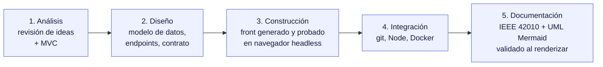

# Camino Seguro — Documento de uso de inteligencia artificial

**Versión 1.1 · 4 de noviembre de 2026** · Equipo: Yeison Hernández · Alejandro Martínez · Alejandro Nieto

## 1. Herramientas usadas

| Herramienta | Modelo | Quién la usó | Para qué |
|---|---|---|---|
| **Claude** (claude.ai, con herramientas de código, terminal y navegador) | Claude Opus 5.5 | Yeison (frontend y documentación) | Revisar las ideas, plan por horas, modelo de datos, contrato de la API, generar y **probar** el frontend Angular, Docker, documentación y diagramas Mermaid |
| **Claude** (claude.ai, conversación del mismo proyecto) | Claude Opus 5.5 | Alejandro Martínez (backend) | Generar el backend .NET 8 siguiendo el contrato del `README` del frontend y adaptarlo a los modelos que él ya tenía |
| Búsqueda web integrada en Claude | — | Yeison | Verificar que Angular 22.2.5 existe y sus requisitos (TypeScript 6, Node) |

**Principio de trabajo:** la IA propone y el equipo decide y verifica. Ningún código entró al repositorio sin compilarse y probarse.

---

## 2. Cómo se usó en cada fase

---

## 3. Prompts más importantes

**P1 — Contexto y planeación (8:50 a. m.).** Le dimos un prompt largo y estructurado con el problema, el ciclo, las tecnologías, la rúbrica, las entregas y la hora límite, y le pedimos explícitamente que no escribiera código todavía. Fragmento:
> «Antes de escribir código, revisa nuestras ideas y dinos qué está bien y qué cambiarías. Arma un plan por horas […] Avísanos de problemas de seguridad […] Si te falta información, pregúntanos antes de suponer.»

*Resultado:* corrigió nuestra idea de cercanía (no habíamos definido «cercanía a qué»), propuso cómo justificar MVC con Angular, entregó el modelo de datos y 13 endpoints, y advirtió de un error de SQL Server (*multiple cascade paths*) antes de que nos pasara.

**P2 — Versión de Angular.**
> «como actualizo la version de angular a la 22.2.5»

*Resultado:* buscó en la web y **confirmó que la versión existe** antes de responder. Además advirtió que Angular 22 no funciona con Node 20.

**P3 — Construcción del frontend.**
> «nieto esta trabajando en el git, martinez en el back, ayudame a hacer el front»

*Resultado:* generó el proyecto con Angular CLI 22.2.5, lo compiló y lo **probó en un Chrome sin interfaz simulando un celular**: inicio de sesión, crear un reporte y ver la lista y el mapa. También creó un *backend simulado* para que el frontend funcionara sin esperar a la API.

**P4 — Entender el mapa.**
> «como funciona el mapa del front y que necesita del backent»

*Resultado:* explicación que usamos para coordinar con el backend: qué campos necesita el mapa y las reglas de uso de Nominatim.

**P5 — Docker y documentación.**
> «acoplar el proyecto para docker […] documentación de arquitectura y decisiones técnicas (UML IEEE) y manuales, también documentar uso de la IA, los diagramas de uml […] con mermaid»

*Resultado:* Dockerfile en dos etapas, nginx con cabeceras de seguridad, docker-compose y estos documentos. Los 12 diagramas se **renderizaron con mermaid-cli** para confirmar que no tienen errores de sintaxis.

**P6 — Backend a partir del contrato (Martínez).** Pegó el `models.ts` del front y pidió:
> «creame lo que deberia ir en el back que responda a lo que hay en front»

Luego aclaró la versión: «en 8.0».

*Resultado:* un backend ASP.NET Core 8 con los nombres de campos idénticos al front, rate limiting, validación con DataAnnotations, Nominatim con descarte a más de 25 km, `Dockerfile` y Swagger con JWT.

**P7 — Revisión cruzada (Yeison).** Antes de desplegar le pedimos a Claude revisar el back contra el front y el `docker-compose`.

*Resultado:* encontró tres problemas reales que nadie había visto. Primero, detrás de nginx el *rate limiting* iba a bloquear a todos a la vez; se corrigió con `UseForwardedHeaders`. Segundo, CORS no tomaba la variable del compose por estar definido como lista. Tercero, el front aceptaba alias de 2 a 40 caracteres y el back solo de 3 a 30.

---

## 4. Evaluación crítica

### 4.1 Lo que la IA hizo bien
| Aspecto | Evidencia |
|---|---|
| Detectó vacíos en los requisitos | Señaló que «ordenar por cercanía» necesitaba un punto de referencia, y propuso usar el GPS o el municipio |
| Seguridad desde el diseño | Popups del mapa con `textContent` (anti-XSS), protección contra redirección abierta en el login, token solo hacia la API propia, CSP compatible con el build |
| Trabajo en paralelo | El contrato JSON y el backend simulado permitieron que el frontend y el backend avanzaran a la vez desde la primera hora |
| Verificó en lugar de suponer | Buscó la versión de Angular, compiló, probó en el navegador y renderizó los diagramas |
| Explicaciones defendibles | Cada decisión vino con su porqué; de ahí salió la tabla de ADR del documento de arquitectura |

### 4.2 Lo que la IA hizo mal (y cómo lo detectamos)
| Error | Cómo se detectó | Corrección |
|---|---|---|
| El primer zip traía el README genérico de Angular, no el que tenía el contrato de la API: un comando propio de la IA interrumpió el paso que lo escribía | **Lo notamos nosotros** al ver con `dir` que el README pesaba 1.463 bytes | Volvió a generar el README y lo entregó aparte |
| Probó con Node 22 en su entorno y no anticipó que Angular 22.2 exige Node ≥ 24.15. En el PC teníamos la 24.14 | `npm start` falló en el PC del equipo | Actualizamos Node con `winget` |
| Dio comandos de **PowerShell** cuando estábamos en **CMD** | Error `'Copy-Item' is not recognized` | Pasó a comandos de CMD (`tar`, `xcopy`) |
| Dio varios comandos juntos sin insistir en que se pegaran uno por uno y dentro del repo. Se ejecutaron en la carpeta equivocada y dejaron archivos sueltos | `dir` mostró archivos duplicados en `hackaton` | Desde ahí dio un comando por bloque y guió la limpieza archivo por archivo, sin borrar a ciegas |
| En su primera versión, el backend simulado perdía la sesión al recargar la página | Su propia prueba automática falló con un 401 | Corrigió el formato del token simulado |
| No pudo construir la imagen de Docker porque su entorno no tenía el servicio de Docker. En la conversación del back tampoco pudo compilar .NET | Lo dijo explícitamente | Verificó los pasos del Dockerfile por separado. La prueba real de `docker compose up` la hizo el equipo en Docker Desktop |
| En la conversación del back generó **dos versiones distintas**: un zip con un proyecto nuevo y, después, cambios directos en el proyecto de Martínez | Al buscar «el archivo del back» había dos candidatos con datos distintos | El equipo eligió una sola versión (el zip) y la subió a `main` |
| Los documentos decían .NET 10 y BCrypt, pero el back se hizo en .NET 8 con `PasswordHasher` (PBKDF2), porque Martínez pidió .NET 8 | Revisión del código real antes de entregar | Documentos actualizados a la versión 1.1 con los datos reales |

### 4.3 Límites que la IA no resuelve
- **Decisiones éticas:** que el sistema señale lugares y no personas, y cómo manejar reportes falsos, lo decidimos nosotros. La IA solo propuso controles.
- **Validación del dominio:** las coordenadas de los municipios de la demo son aproximadas y hay que verificarlas.
- **No se puede verificar el género** de quien se registra. Lo dejamos documentado como riesgo.

### 4.4 Buenas prácticas que aplicamos
1. Dar contexto completo: rúbrica, tiempos, tecnologías y restricciones.
2. Pedir que **pregunte antes de suponer** y que **explique el porqué** de cada decisión.
3. **Nunca pegar secretos** (claves JWT, contraseñas) en los prompts.
4. Leer, compilar y probar todo lo generado antes de hacer commit.
5. Registrar los errores de la IA, como en este documento, para no repetirlos.

### 4.5 Conclusión
La IA multiplicó nuestra velocidad, sobre todo en estructura, seguridad y documentación. Pero **los errores más costosos fueron de contexto del entorno**: la versión de Node, la terminal que usábamos y las carpetas. Esos los detectó el equipo. La IA funcionó como un asistente experto que hay que supervisar, no como un reemplazo del criterio técnico.
